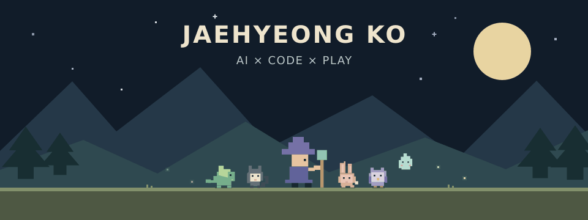
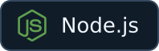

  

## 안녕하세요, 고재형입니다

Python과 JavaScript로 도구를 만들고, Codex와 Claude Code를 함께 씁니다.  
요즘 관심사는 자동화, MCP, 그리고 작은 게임입니다.  
픽셀 아트와 움직이는 캐릭터를 좋아합니다.

## 만들어 본 것

- **[시트에서 문서 만들기](https://github.com/koeje1/operations-automation-lab/tree/main/poc-application-automation)**  
  시트와 설문 데이터를 연결해 Docs·PDF를 만들고, 내용이 바뀌면 다시 생성하는 Apps Script 코드입니다.

- **[픽셀 배너 실험](https://github.com/koeje1/github-profile-banner-animation)**  
  캐릭터, 마법 효과, 조명을 따로 움직여 하나의 GIF로 합성했습니다.

  

## Languages & Tools

**개발**

  
  
  
  
  
  

**웹 · 도구**

  
  
  
  

**연동**

  
  
  
  

  

