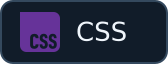
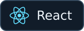
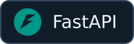
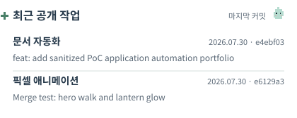

  

## 안녕하세요, 고재형입니다

**만들고 싶은 게 생기면 직접 만들어 봅니다.**

회사에서 쓸 관리 사이트를 만들기도 하고, 반복하는 일을 자동화하거나 게임에 새 기능을 붙여 보기도 합니다. Python과 JavaScript/TypeScript를 주로 쓰고, Codex와 Claude Code를 함께 사용해 구현하고 검토합니다.

게임과 픽셀 아트, 버튼을 눌렀을 때 반응하는 웹페이지를 좋아합니다. 이 프로필의 마법사와 다섯 동료도 그런 취향을 담았습니다.

## 요즘 만드는 것

지금은 **회사에서 사용할 관리 사이트**를 구축하고 있습니다. 예산과 지출을 입력·검토하는 화면부터 DB 저장, 집계, 엑셀 출력까지 연결하는 중입니다. 시트에서 여러 행을 붙여넣고, 중복이나 잘못된 입력을 확인한 뒤 저장하는 기능도 만들고 있습니다. 화면은 JavaScript, 서버는 Node.js, 데이터는 PostgreSQL로 구성했습니다.

문서와 데이터를 다루는 도구도 만들고 있습니다.

- **영수증 정산 자동화** — Python과 PaddleOCR로 영수증을 읽고 거래내역과 대조합니다. 검토가 끝난 항목으로 정산 서류를 만드는 작업을 개발 중입니다.
- **Discord MCP** — Discord의 메시지와 스레드를 AI에서 찾아볼 수 있도록 TypeScript로 도구를 연결했습니다.

최근에는 **스마트폰 투표와 행사장 화면을 연결하는 웹앱**도 만들었습니다. 참여자·진행자·송출 화면을 나누고, SSE로 투표 상태를 갱신하며 PostgreSQL에 세션과 투표를 저장합니다.

## 재미로 만드는 것

Python으로 끝말잇기와 자동차 경주 같은 작은 게임을 만들며 공부했고, 지금은 레트로 게임에 **WebSocket 멀티플레이** 기능을 붙여 보고 있습니다. React·Vite·Supabase로 버튼 반응, 음악, 방명록이 있는 웹페이지도 만들었습니다.

픽셀 애니메이션도 계속 만지는 취미 중 하나입니다. 캐릭터와 효과를 따로 움직이고 GIF로 합치면서, 마음에 드는 움직임이 나올 때까지 조금씩 손봅니다.

## 공개 코드와 개발 기록

- **[시트에서 문서 만들기](https://github.com/koeje1/operations-automation-lab/tree/main/poc-application-automation)** — 시트·설문 데이터를 연결해 Docs와 PDF를 생성하고, 원본이 바뀌면 다시 만드는 Apps Script 코드입니다.
- **[픽셀 배너 실험](https://github.com/koeje1/github-profile-banner-animation)** — 캐릭터·마법 효과·조명의 재생 시간을 따로 조절해 GIF로 합성한 기록입니다.

처음 만들었던 게임과 웹페이지

| 개발 기록 | 만들어 본 것 | 사용 기술 |
|---|---|---|
| [Python 게임](https://github.com/koeje1/final_project) | 끝말잇기, 자동차 경주 등 콘솔 프로그램 | Python |
| [게임·웹앱 실습](https://github.com/koeje1/final_kokker) | 구조를 나눈 콘솔 게임과 질문·답변 웹앱 | Python · FastAPI · Svelte |
| [첫 웹페이지](https://github.com/koeje1/my_first_web_site) | 페이지 연결, 이미지와 글 배치 | HTML · CSS |

  

## Languages & Tools

**개발**

  
  
  
  
  
  

**웹 · 도구**

  
  
  
  

**연동**

  
  
  
  

**다른 프로젝트에서 사용**

  
  
  
  
  

## 최근 공개 작업

<picture>
  <source media="(prefers-color-scheme: dark)" srcset="./assets/activity/public-work-dark.svg" />
  
</picture>

[문서 자동화 기록](https://github.com/koeje1/operations-automation-lab/commits/main) · [픽셀 배너 기록](https://github.com/koeje1/github-profile-banner-animation/commits/main)

  

