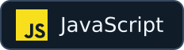
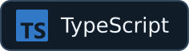
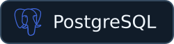
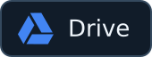

<!-- Profile V2.1: animated scenes and local logo badges; essential information remains text. -->

  

  <strong>운영을 이해하고, 쓰이는 도구를 만듭니다.</strong> 
  JAEHYEONG KO · Operations × AI × Automation

## About

교육·사업 운영 경험을 바탕으로, 반복 업무를 실제로 쓰는 시스템과 자동화 도구로 바꿉니다.

예산·정산, 문서 처리, 흩어진 데이터처럼 **기준과 예외가 많은 일**에 관심이 있습니다. 빠르게 입력하고, 명확하게 검토하고, 다시 확인할 수 있는 흐름을 만듭니다.

AI와 함께 설계하고 구현하며, 계산과 업무 기준은 코드와 검증으로 확인합니다.

## Selected Work

### Google Workspace Document Automation

시트와 설문 데이터를 연결해 문서·PDF를 만들고, 원본 변경에 따라 생성 상태를 관리합니다.

**Google Apps Script · Sheets · Docs · Drive**  
[공개 코드 보기](https://github.com/koeje1/operations-automation-lab/tree/main/poc-application-automation)

### Operations Workspace

예산·지출·출강 기록의 입력, 검토, 집계와 엑셀 출력을 연결하는 업무 도구를 개발하고 있습니다.

**JavaScript · Node.js · PostgreSQL**  
개발 중 · 비공개

### Receipt Processing Pipeline

영수증에서 추출한 정보를 거래내역과 대조하고, 검토가 필요한 항목을 분리해 정산 문서 생성으로 이어지는 흐름을 개발하고 있습니다.

**Python · PaddleOCR · Google Sheets API**  
개발 중 · 비공개

### Discord MCP Integration

Discord의 정보를 정해진 범위에서 조회할 수 있도록 MCP 도구로 연결했습니다.

**TypeScript · MCP · discord.js**  
구현·개선 중 · 비공개

  

## Stack

**Core**

  
  
  
  
  
  

**Web & tools**

  
  
  
  

**Workspace & integrations**

  
  
  
  

OCR workflow · PaddleOCR · Google Sheets API

## How I Work

- **기준부터 정리합니다.** 원본 데이터와 예외 조건을 이해한 뒤 자동화합니다.
- **작게 만들고 확인합니다.** 실제 입력과 검토 과정에서 불편한 부분을 줄입니다.
- **결과를 다시 확인할 수 있게 만듭니다.** 계산 근거와 수정 흐름을 함께 생각합니다.

Side Quest · <a href="https://github.com/koeje1/github-profile-banner-animation">Pixel animation experiments</a>

  

